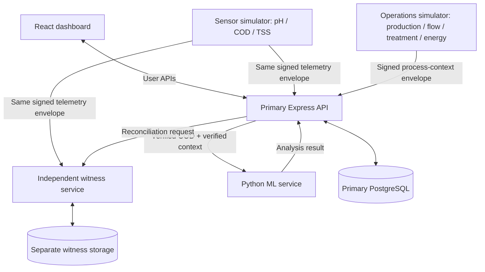

# 03 — System Architecture and Data Flows

## 1. Architecture goals

- Keep the system implementable in approximately 15 hours.
- Make sensor identity, primary verification and witness verification logically separate.
- Prevent React from holding device or witness private keys.
- Let the witness receive signed data directly from the simulator, not only a backend assertion.
- Keep ML outside the cryptographic trust path.
- Preserve clear failure states when one service is unavailable.

## 2. Services

### 2.1 React dashboard (`apps/web`)

Human interface only. It performs user authentication, calls primary APIs and displays data. It never signs sensor messages and never receives device/witness private keys.

### 2.2 Primary API (`apps/api`)

Node.js/Express. Responsibilities:

- User authentication and RBAC.
- Site/station/sensor/key registry.
- Telemetry ingestion and Ed25519 verification.
- Sequence/freshness checks.
- Primary telemetry persistence.
- Primary event hash chain.
- Heartbeat monitoring.
- Operational-context verification.
- Calling ML service asynchronously or with a bounded timeout.
- Reconciliation with witness service.

### 2.3 Sensor simulator (`apps/sensor-simulator`)

A separate Node.js process. One logical device per sensor identity. It owns local private keys, generates signed readings and sends the identical signed envelope to primary and witness. It can run normal and controlled abnormal scenarios.

### 2.4 Operations simulator (`apps/ops-simulator`)

A separate logical source with its own Ed25519 key pair. Generates production rate, wastewater flow, treatment dose, energy use and operating mode. It signs operating-context records. The primary API verifies them before storing or using them for ML.

### 2.5 Independent witness (`apps/witness`)

A separate Node.js service with a separate signing key and separate storage. It receives signed telemetry and heartbeats directly from sensors, independently verifies device signatures, stores its own records and creates its own hash chain. It signs periodic checkpoints. It provides read-only verification APIs to the auditor/primary reconciliation process.

For the 15-hour prototype, this service can run locally as a separate process and use a separate database/file-backed store with separate credentials. This is logical independence only. Production independence requires separate infrastructure, administration and access controls.

### 2.6 ML service (`services/ml`)

Python + FastAPI + scikit-learn. Receives verified COD readings and verified, time-aligned operations context. Returns anomaly analysis. It does not have authority to approve keys, verify signatures, alter readings or decide legal compliance.

## 3. Logical architecture

## 4. Data flow: sensor reading

1. Simulator creates a telemetry payload using the schema in `contracts/telemetry.schema.json`.
2. It uses RFC 8785 JCS canonicalization.
3. It signs canonical UTF-8 bytes using the sensor's local Ed25519 private key.
4. It creates an envelope containing payload and Base64 signature.
5. It sends the same envelope to `POST /api/v1/ingestion/readings` and `POST /witness/v1/ingestion/readings` over HTTPS.
6. Primary validates schema, approved key, key-to-device mapping, signature, timestamp, boot ID and sequence.
7. Witness independently performs its own schema, key, signature and sequence checks using its separately provisioned public-key registry.
8. Each service stores its own copy and creates its own chained event.
9. Witness signs a checkpoint at the configured threshold.
10. Primary sends the accepted reading plus the most recent verified operational context to ML.
11. Dashboard shows independent statuses.

If one submission fails, the simulator retries the same envelope and same `messageId`. Do not create a fresh message ID or sequence for a retry. Both APIs must be idempotent.

## 5. Data flow: operations context

1. Operations simulator creates an interval-level record using `contracts/ops-context.schema.json`.
2. It signs the record with its own `OPS-001` private key.
3. It sends the signed envelope to primary API.
4. Primary checks the operations key and signature.
5. Primary stores it with interval start/end and server receipt time.
6. ML may use it only when it matches the COD reading's site/station and configured time window.
7. Missing/stale/invalid context produces `NOT_EVALUATED`.

Operations simulator is a separate logical source, but because the entire prototype is synthetic, this is not genuinely independent industrial evidence. State this limitation in the UI/report.

## 6. Data flow: heartbeat

1. Each sensor periodically creates a heartbeat payload.
2. It signs the heartbeat payload with the same sensor private key.
3. It sends the same signed heartbeat to primary and witness.
4. Each service updates its own last-seen state.
5. A scheduled backend check marks the sensor `OFFLINE` after three missed intervals plus grace period.
6. Status recovers when valid heartbeats resume.

Do not report “factory deliberately disabled sensor”; report “no recent authenticated heartbeat.”

## 7. Data flow: witness and audit

1. Witness independently validates the sensor envelope.
2. Witness stores the payload hash, signature, message ID, sequence, sensor ID and receipt time.
3. Witness constructs its own ordered event record and hash chain.
4. Every N accepted records per station, witness signs a checkpoint.
5. The checkpoint is persisted in witness storage and exposed read-only.
6. Primary/auditor requests reconciliation for a time range or sequence range.
7. Reconciliation compares message IDs, payload hashes, sequence numbers and checkpoint state.
8. Any mismatch is displayed as a discrepancy, not silently repaired.

## 8. Data flow: ML

1. Primary verifies COD telemetry.
2. Primary finds signed, verified operating-context data for the matching interval.
3. Primary sends feature values and reading ID to ML.
4. ML predicts expected COD and calculates residual against validation-derived threshold.
5. ML also applies flatline/sudden-change rules using verified reading history.
6. ML returns an immutable analysis result with model version and explanation.
7. Primary stores analysis separately from telemetry.
8. Dashboard shows `CONSISTENT`, `SUSPICIOUS` or `NOT_EVALUATED`.

## 9. Failure behaviour

- Primary down: sensor retains/retries envelope; witness may still receive it. Dashboard indicates primary unavailable.
- Witness down: primary may accept and store valid telemetry, but witness status remains `PENDING`/`LAGGING`. Retry same message ID. Do not label record independently witnessed until receipt arrives.
- ML down: telemetry ingestion and audit continue. ML result is `PENDING` or `NOT_EVALUATED_SERVICE_UNAVAILABLE`.
- Operations context missing: COD process model does not run; no stale data substitution.
- Database transaction failure: return retryable server error; do not report accepted unless committed.
- Duplicate message: return idempotent duplicate response; do not append a second accepted event.

## 10. Deployment for demo

Use separate local processes and separate port numbers. Example only; exact ports may be adjusted to avoid conflict:

- React: `5173`
- Primary API: `4000`
- Witness: `4001`
- ML: `8000`
- Primary PostgreSQL: configured DSN
- Witness storage: separate DSN or a separate protected file-backed store

The simulator is a process, not a public web application. Keep private keys in a local key directory ignored by Git.
